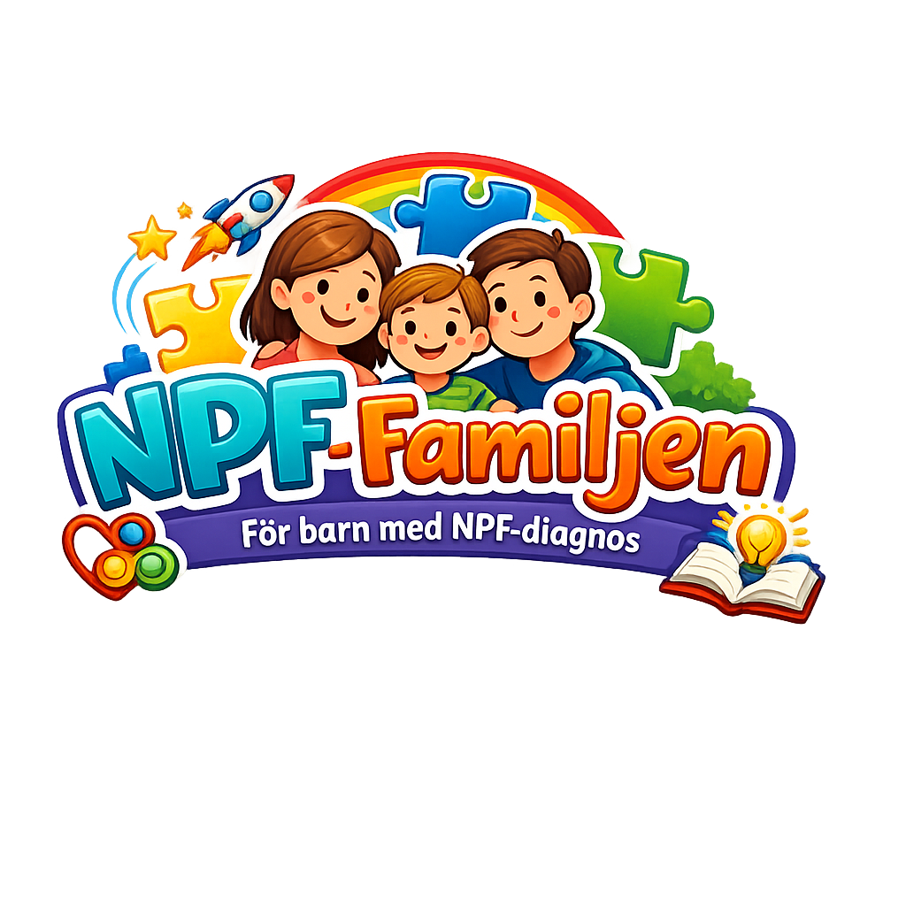

# NPF-familjen

Ett hjälpmedel för barn och familjer med NPF-problematik (t.ex. ADHD och autism): uppgifter, rutiner och packlistor med bildstöd, veckomatsedel, skolmat och en hemskärm som visar familjens dag.

## Dokumentation

- [Arkitektur](docs/ARCHITECTURE.md): stack, datamodell och regler
- [Roadmap](docs/ROADMAP.md): milestones i byggordning
- [Stilguide](docs/STYLEGUIDE.md): färger, typsnitt och komponenter, med [tokens](docs/design/tokens.json) och [utkast av hemskärmen](docs/mockups/)

## AI-stöd

Projektets regler för AI-verktyg ligger i [.ai/guidelines/](.ai/guidelines/). Laravel Boost tar med dem i `CLAUDE.md`, `AGENTS.md` och `.github/copilot-instructions.md`.
